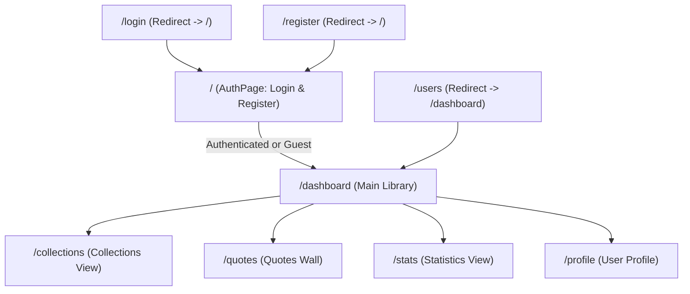
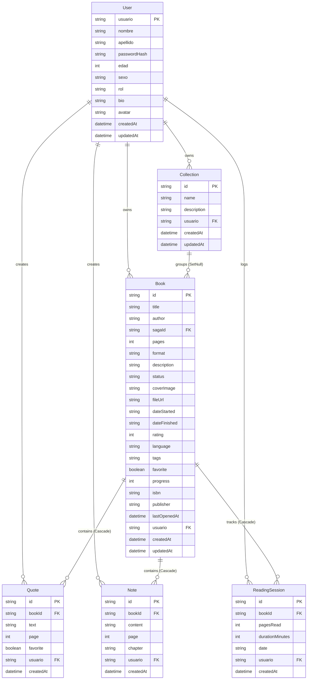
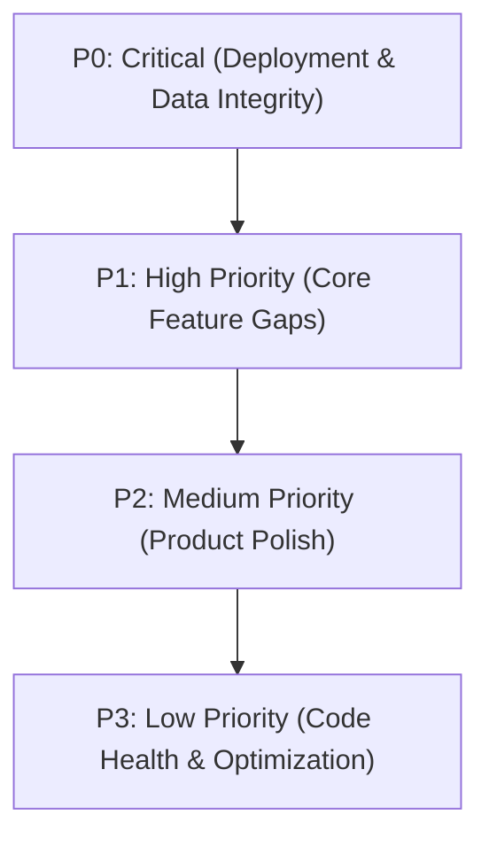

# FULL PROJECT AUDIT & TECHNICAL CONTEXT: LITHUB

> **Document Version:** 1.0.0  
> **Audit Date:** November 2026  
> **Audited By:** Antigravity AI Assistant  
> **Repository:** `https://github.com/DamRandom/LitHub.git`  
> **Environment:** Next.js 15 (App Router), React 19, Prisma 6, PostgreSQL (Neon), Tailwind CSS v4, TypeScript 5  

---

## Executive Summary

**LitHub** is a modern, responsive personal reading tracker and digital library management web application designed for passionate readers. It allows users to catalog physical books, store and extract metadata from digital publications (EPUB and PDF), read books directly in the browser with an interactive e-reader (featuring realistic page turns, customizable typography, and themes), log reading sessions, highlight passages, collect meaningful quotes, organize books into sagas and collections, and analyze annual reading statistics.

The application is in an **advanced prototype / late-alpha** stage. It recently underwent a major architectural migration: transitioning from a purely client-side/SQLite desktop-style app to a full-stack Next.js application backed by a Neon PostgreSQL cloud database and JWT-based cookie authentication.

While the primary user interface is exceptionally polished—featuring fluid physics animations, responsive book cards with tactile spine effects, and a rich e-reader modal—the audit revealed several critical architectural gaps and incomplete backends:
1. **Reading Session Persistence Gap:** The database schema defines `ReadingSession`, but there are no backend API endpoints (`/api/sessions` does not exist). In-memory reading sessions are wiped upon every browser reload, rendering long-term reading stats ineffective.
2. **Local Storage / Ephemeral Filesystem Risk on Vercel:** File upload and metadata extraction (`/api/upload` and `/api/upload/extract`) currently write files directly to `public/uploads/books/` and `public/uploads/covers/`. On Vercel or serverless deployments with read-only filesystems, this causes runtime errors (`EROFS`) and data loss across cold starts.
3. **Destructive Complete Book Endpoint:** The `/api/books/[id]/complete` API route performs an atomic delete of the `Book` record from the database instead of updating its status to `finished`.
4. **Note Updates Not Persisted:** `updateNote` in the client context updates React state only; no `PUT` API endpoint exists in `/api/notes/[id]/route.ts`.
5. **Legacy & Orphaned Code Artifacts:** Multiple legacy files remain from earlier development iterations, including `src/lib/auth-store.ts`, unused CRUD modals in `src/components/users/`, duplicate interfaces in `src/types/book.ts`, and residual SQLite binaries in `prisma/`.

---

## 1. Project Overview

### 1.1 Purpose & Problem Statement
Voracious readers often struggle with fragmented reading workflows: physical books are tracked in simple spreadsheets or Goodreads, digital books (EPUBs/PDFs) are trapped in isolated e-reader apps (Apple Books, Kindle, Calibre), and quotes or reflections are scattered across notebooks and smartphone notes apps. 

**LitHub** addresses this fragmentation by offering a unified "Reading Sanctuary":
- A single dashboard for both physical copies and digital files (EPUB/PDF).
- Direct browser-based reading without requiring external desktop software.
- In-line highlighting, quote preservation, and chapter-by-chapter note-taking.
- Reading timer and session logger that feeds into visual annual statistics.
- Visual series/saga organization for book series.

### 1.2 Target Audience
- Avid book readers, students, and researchers who maintain mixed physical/digital libraries.
- Readers seeking a private, clutter-free reading environment without social media bloat.
- Fans of book sagas who want clear visibility over reading order and completion.

### 1.3 Core Objectives
1. **Frictionless Book Cataloging:** Quick manual entry or automated metadata extraction from EPUB/PDF files.
2. **Deep Reading Experience:** Built-in EPUB reader with customizable themes (Light, Sepia, Dark), adjustable typography, 3D page-flip animations, and instant quote clipping.
3. **Session & Habit Tracking:** Real-time reading timers, page-tracking logs, and interactive charts displaying monthly reading momentum.
4. **Quote & Reflection Sanctuary:** Dedicated quote board with favoriting, search, and book association.
5. **Zero-Friction Preview:** Instant "Guest Mode" allowing prospective users to explore the interface without immediate registration.

### 1.4 Primary User Workflows
1. **Onboarding / Authentication:**
   - Visitor lands on `/` (interactive split card with liquid-inertia mouse lighting).
   - Can register with username, name, age, gender, and password.
   - Alternatively, can click "Guest Mode" to test the app with seeded demo data (`Blood and Moonlight` saga).
2. **Library Dashboard Navigation:**
   - User arrives at `/dashboard`.
   - The **"Continue Reading"** hero showcases the most recently opened book with progress bar and direct "Read" action.
   - The **"Want to Read"** carousel displays pending books awaiting reading.
   - The **Tab Section** provides switching between Collections, Finished Books, Quotes, and Reading Statistics.
3. **Adding a Book:**
   - User clicks `+ Add` in Navbar or `Añadir libro` on dashboard.
   - Step 1: Select between uploading an EPUB/PDF file or entering manual book details.
   - Step 2: System extracts title, author, description, page count, and cover image automatically, or user types them.
   - Step 3: Book is saved to database (or guest local storage) and placed in the library.
4. **Reading & Interacting (`BookReaderModal`):**
   - User clicks `Leer` / `Continuar Lectura`.
   - The modal loads the EPUB file using `epubjs` or embeds the PDF via `<iframe>`.
   - Reader can flip pages, switch to Dark/Sepia mode, zoom font size, or start a live reading timer.
   - Highlighting text in the reader triggers an arrow-clamped popover to save the passage as a Quote or Note.
5. **Collection / Saga Management:**
   - User visits `/collections` to create series (e.g., "Blood and Moonlight"), associate books via `sagaId`, and sort/filter by name or author.

### 1.5 Technology Stack

| Layer | Technology | Version | Purpose |
|---|---|---|---|
| **Framework** | Next.js (App Router) | `15.5.24` | SSR, Hybrid Routing, API Routes, Asset Optimization |
| **Frontend Runtime** | React & React-DOM | `19.0.0` | Modern component rendering, hooks, concurrent features |
| **Language** | TypeScript | `5.x` | Static typing across server and client code |
| **Styling** | Tailwind CSS v4 (`@tailwindcss/postcss`) | `4.x` | Modern CSS variables, `@theme inline`, fluid utility design |
| **Animation** | Framer Motion | `12.12.1` | Layout transitions, spring physics, page-flip simulations |
| **Database ORM** | Prisma | `6.19.3` | Schema definition, migrations, type-safe query building |
| **Database Engine** | PostgreSQL (Neon Serverless) | Compatible PG 15/16 | Cloud relational database with connection pooling |
| **Authentication** | JWT (`jsonwebtoken`) + `bcryptjs` | `9.0.2` / `3.0.2` | Stateless HTTP-only cookie sessions and password hashing |
| **E-Reader Core** | `epubjs` & `epub2` | `0.3.93` / `3.0.2` | In-browser EPUB rendering and server-side EPUB metadata/cover extraction |
| **PDF Extraction** | `pdf-parse` | `2.4.5` | Server-side PDF title and page count inspection |
| **Charts** | Recharts | `3.10.0` | SVG-based monthly reading time visualization |
| **Icons** | Lucide React & React Icons | `0.487.0` / `5.5.0` | Modern UI icon library |

---

## 2. Features and Functionalities Inventory

### 2.1 User Authentication & Profile
- **Registration (`/api/auth/register`):** Creates user record with bcrypt password hash, validates unique username, assigns default role, and automatically seeds sample books for the user.
- **Login (`/api/auth/login`):** Validates credentials, issues a signed JWT stored in an `httpOnly`, `sameSite: lax`, 30-day cookie (`lithub_session_token`).
- **Session Verification (`/api/auth/me`):** Server endpoint verifying the cookie and returning sanitized user profile.
- **Guest Mode (`loginAsGuest`):** Bypasses DB; stores local state in `sessionStorage` (`lithub_guest`) and demo data in `localStorage` (`lithub_guest_data`).
- **Profile Management (`/profile`, `/api/auth/profile`):** Updates first name, last name, age, gender, bio, and optionally updates password.
- **Logout (`/api/auth/logout`):** Clears the session cookie and redirects user.

### 2.2 Book Catalog & Reading State Management
- **Book Schema:** Stores title, author, description, page count, format (`physical`, `pdf`, `epub`), status (`unread`, `reading`, `finished`, `abandoned`), progress percentage, cover image URL, file URL, dates started/finished, rating (1-5), language, ISBN, publisher, and tags.
- **Book Listing (`/api/books`):** Retrieves user's books ordered by creation date, parses JSON tags.
- **Book Details Modal (`BookDetailModal.tsx`):** Displays metadata, allows changing reading status, modifying progress percentage, toggling favorites, viewing associated quotes/notes/sessions, and deleting the book.
- **Finished Books View (`FinishedBooks.tsx`):** Filters books with `status === 'finished'`, displays ratings, completion dates, and a "Releer" (re-read) button.
- **Want to Read List (`BooksToReadLater.tsx`):** Horizontal scroll showcase of unread and un-opened books with quick "Read" overlay.

### 2.3 Interactive In-Browser E-Reader (`BookReaderModal.tsx`)
- **EPUB Engine:** Integrates `epubjs` inside an iframe/container. Renders chapters, manages continuous scrolling or paginated spreads, and supports text selection.
- **PDF Viewer:** Embeds native browser PDF viewer with anchor parameters (`#page=X&toolbar=1`).
- **Physical Book Mode:** Fallback screen providing timer controls, manual page logger, and note-taking panel for printed books.
- **Themes & Typography:** Light, Sepia, and Dark color schemes; adjustable font sizes (80% to 150%).
- **Selection Popover & Quotation Tool:** Calculates viewport bounding rectangles and displays a floating action pill above/below selected text to save as a Quote or Note.
- **Reading Timer:** In-reader stopwatch for tracking active reading duration in seconds.

### 2.4 Collections & Series Management (`Collections.tsx`)
- **Collection CRUD (`/api/collections`, `/api/collections/[id]`):** Create, rename, edit description, and delete collections.
- **Book Association:** Books link to collections via `sagaId`. Deleting a collection cascades to `SetNull` on books without deleting books.
- **Search & Sort:** Live text search through collection names, book authors, and tags. Multi-criteria sorting (by name, author, date created) with ascending/descending toggle.

### 2.5 Quotes Management (`Quotes.tsx`, `QuotesList.tsx`)
- **Quote CRUD (`/api/quotes`, `/api/quotes/[id]`):** Create quote with text, book association, page number, and favorite flag.
- **Quote Wall:** Masonry-style quote display featuring custom quotation styling, book cover thumbnail, page reference, and search filter.
- **Favoriting:** Instant toggle of quote favorite status with database persistence.

### 2.6 Notes Management (`NotesList.tsx`)
- **Note CRUD (`/api/notes`, `/api/notes/[id]`):** Create notes associated with specific books, chapters, and page numbers.
- **Book-level Notes List:** Collapsible note cards with markdown-style line breaks and timestamping.
- **Note Deletion:** Deletes note via `DELETE /api/notes/[id]`.

### 2.7 Reading Statistics (`Stats.tsx`)
- **Annual Overview:** Aggregates books finished, pages read, total minutes read, and active months.
- **Bar Chart:** Monthly reading distribution chart powered by Recharts.
- **Year Selector:** Dropdown filter dynamically populated from session and book completion dates.

### 2.8 File Upload & Metadata Extraction (`/api/upload`, `/api/upload/extract`)
- **Upload Endpoint (`/api/upload`):** Accepts `.epub` and `.pdf`, saves to `public/uploads/books/`. (Disabled in production with HTTP 501).
- **Extraction Endpoint (`/api/upload/extract`):** Parses EPUB metadata via `epub2` and PDF metadata via `pdf-parse`. Extracts book title, author, description, ISBN, estimated page count, and extracts cover image to `public/uploads/covers/`.

---

## 3. Implementation Status Matrix

The following matrix classifies every major functionality based on code-level verification:

| Feature / Module | Status | Description | Implementation Details | Pending Work |
|---|---|---|---|---|
| **User Registration** | ✅ IMPLEMENTED | Creates new user in PostgreSQL with bcrypt hash | `src/app/api/auth/register/route.ts` | Email validation, captcha, email verification |
| **User Login (JWT)** | ✅ IMPLEMENTED | Authenticates credentials and sets httpOnly cookie | `src/app/api/auth/login/route.ts`, `src/lib/auth-jwt.ts` | Refresh token mechanism, remember-me duration options |
| **Session Verification** | ✅ IMPLEMENTED | Validates cookie and returns sanitized user payload | `src/app/api/auth/me/route.ts`, `src/lib/auth-context.tsx` | Next.js Edge Middleware route guarding |
| **User Profile Edit** | ✅ IMPLEMENTED | Updates name, age, bio, gender, and password | `src/app/api/auth/profile/route.ts`, `src/app/profile/page.tsx` | Avatar file upload, account deletion |
| **Guest Mode Preview** | ✅ IMPLEMENTED | Fully functional offline sandbox using localStorage | `src/lib/auth-context.tsx`, `src/lib/sample-books.ts` | One-click migration from Guest to registered account |
| **Password Recovery** | ⚪ NOT IMPLEMENTED | No forgot password or reset mechanism exists | None | Need token generation, email integration (Resend/SendGrid) |
| **OAuth (Google)** | ⚪ NOT IMPLEMENTED | Package installed (`@react-oauth/google`), but no auth flow | Package in `package.json`, dead button in `AuthForm.tsx` | Configure Google Client ID and Next.js callback route |
| **User Admin Management** | 🟠 UI ONLY | Modals exist in code but `/users` page redirects | `src/components/users/*`, `src/app/users/page.tsx` | Admin RBAC check, API `/api/users`, enable page |
| **Book Catalog Fetching** | ✅ IMPLEMENTED | Retrieves user-owned books from DB with tags parsed | `src/app/api/books/route.ts`, `src/lib/context.tsx` | Pagination, server-side search/filtering |
| **Manual Book Creation** | ✅ IMPLEMENTED | Adds book record with validation and tag serialization | `src/app/api/books/route.ts`, `src/components/AddBookModal.tsx` | Cover image upload for manual entry |
| **Book Editing & Progress** | ✅ IMPLEMENTED | Updates rating, progress percentage, dates, format | `src/app/api/books/[id]/route.ts`, `BookDetailModal.tsx` | Form validation feedback, cover replacement |
| **Book Deletion** | ✅ IMPLEMENTED | Deletes book row; cascades to quotes, notes, sessions | `src/app/api/books/[id]/route.ts`, `BookDetailModal.tsx` | Soft delete / archive option |
| **Complete Book Endpoint** | 🔴 BROKEN | Endpoint deletes the book record upon completion | `src/app/api/books/[id]/complete/route.ts` | Change `tx.book.delete` to status update only |
| **EPUB Digital Reading** | ✅ IMPLEMENTED | In-browser EPUB rendering via `epubjs` with themes | `src/components/reader/BookReaderModal.tsx` | Bookmark persistence, highlights storage |
| **PDF Reading** | 🟡 PARTIALLY IMPLEMENTED | Embeds iframe with `#page=X`; no native text parsing | `src/components/reader/BookReaderModal.tsx` | Direct PDF highlight support (e.g. `pdfjs-dist`) |
| **EPUB Metadata Extraction**| 🟡 PARTIALLY IMPLEMENTED | Extracts title, author, cover image from EPUB file | `src/app/api/upload/extract/route.ts` | Fails on Vercel read-only filesystem |
| **PDF Metadata Extraction** | 🟡 PARTIALLY IMPLEMENTED | Extracts title, page count from PDF buffer | `src/app/api/upload/extract/route.ts` | Cover thumbnail extraction from PDF first page |
| **Cloud File Storage** | ⚪ NOT IMPLEMENTED | Uses local disk `public/uploads/` (disabled in prod) | `src/app/api/upload/route.ts` | Connect Vercel Blob, Cloudinary, or AWS S3 |
| **Collections / Sagas** | ✅ IMPLEMENTED | Full CRUD, book associations, sorting, and search | `src/app/api/collections/route.ts`, `Collections.tsx` | Custom collection cover image or color picker UI |
| **Quotes Wall & Favoriting** | ✅ IMPLEMENTED | Full CRUD, search, favoriting, book linking | `src/app/api/quotes/route.ts`, `Quotes.tsx` | Share quote as image/card, tag quotes |
| **Notes Creation & Deletion**| ✅ IMPLEMENTED | Creates and deletes notes linked to books | `src/app/api/notes/route.ts`, `NotesList.tsx` | Rich text / markdown editing |
| **Notes Updating (Editing)** | 🔴 BROKEN | UI simulates editing in state; no PUT API endpoint | `src/lib/context.tsx:436`, `src/app/api/notes/[id]` | Add `PUT` handler to `src/app/api/notes/[id]/route.ts` |
| **Reading Session API** | ⚪ NOT IMPLEMENTED | Schema exists but no API endpoints exist | `prisma/schema.prisma:112` | Create `src/app/api/sessions/route.ts` |
| **Session Persistence** | 🔴 BROKEN | In-memory only; cleared upon browser reload | `src/lib/context.tsx:100, 470`, `SessionLogger.tsx` | Wire `addSession` / `deleteSession` to backend |
| **Reading Statistics** | 🟡 PARTIALLY IMPLEMENTED | Renders charts, but session data resets on refresh | `src/components/Stats.tsx` | Connect to persisted sessions; reading goal metrics |

---

## 4. Pages, Screens, and Navigation Structure

### 4.1 Route Inventory



#### Detailed Page Specifications:

1. **`src/app/page.tsx` (`/`) — Authentication Hub**
   - **Purpose:** Primary entry point for unauthenticated visitors. Hosts the unified login and registration experience.
   - **Main Components:** Framer Motion animated glassmorphism cards, fluid-inertia ambient lighting (`useSpring`, `useMotionValue`), password visibility toggles, Guest Mode trigger.
   - **Actions Available:**
     - Toggle between "Sign In" and "Create Account" modes.
     - Submit credentials (login / register).
     - Enter "Guest Mode" (`handleGuestLogin`).
   - **Responsive Behavior:** Full viewport centered layout on desktop; single-column fluid card on mobile screens (`px-4`, `max-w-md`).
   - **Status:** ✅ Fully functional and verified.

2. **`src/app/dashboard/page.tsx` (`/dashboard`) — Main Library Dashboard**
   - **Purpose:** Central hub of the application.
   - **Main Components:**
     - `Navbar` (floating pill header with auto-hide on scroll).
     - Guest mode warning banner (if in guest mode).
     - `ContinueReading` (Hero section highlighting current book).
     - `BooksToReadLater` (Horizontal carousel of pending books).
     - `TabsSection` (Segmented control hosting Collections, Finished Books, Quotes, and Stats).
     - `Footer`.
   - **Route Guarding:** Client-side check redirects to `/` if `!isAuthenticated && !isGuest`.
   - **Status:** ✅ Fully functional.

3. **`src/app/collections/page.tsx` (`/collections`) — Dedicated Collections Page**
   - **Purpose:** Standalone view for managing book series and thematic collections.
   - **Main Components:** `Navbar`, `Collections` component wrapped in `lithub-card`, `Footer`.
   - **Actions Available:** Search collections, sort by name/author/creation, create new collection, delete collection.
   - **Status:** ✅ Fully functional.

4. **`src/app/quotes/page.tsx` (`/quotes`) — Dedicated Quotes Page**
   - **Purpose:** Standalone view for inspecting and filtering saved book excerpts.
   - **Main Components:** `Navbar`, `Quotes` component with masonry layout, `Footer`.
   - **Actions Available:** Text search across quote content and book titles, filter by favorites, toggle favorite heart.
   - **Status:** ✅ Fully functional.

5. **`src/app/stats/page.tsx` (`/stats`) — Dedicated Statistics Page**
   - **Purpose:** Comprehensive reading analytics view.
   - **Main Components:** `Navbar`, `Stats` component, `Footer`.
   - **Data Displayed:** Books read count, total pages read, total hours/minutes logged, active reading months, monthly bar chart.
   - **Status:** 🟡 Partially functional (visuals work, but session data is transient due to lack of DB endpoint).

6. **`src/app/profile/page.tsx` (`/profile`) — Reader Profile Management**
   - **Purpose:** View and update account information, password, and biography.
   - **Main Components:** Personal detail inputs, change password fields, member join date badge, logout button.
   - **Actions Available:** Edit profile (`editUser`), change password, sign out.
   - **Status:** ✅ Fully functional.

7. **`src/app/users/page.tsx` (`/users`) — Legacy Admin Redirect**
   - **Purpose:** Previously served as user administration list.
   - **Current Behavior:** Automatically executes `router.replace('/dashboard')`.
   - **Status:** 🟡 Stub / Redirect only.

8. **`src/app/login/page.tsx` & `src/app/register/page.tsx` — Legacy Redirects**
   - **Purpose:** Preserves backwards-compatible URLs.
   - **Current Behavior:** Redirects authenticated users to `/dashboard` and unauthenticated users to `/`.
   - **Status:** ✅ Functional redirect stubs.

### 4.2 Modal Dialogs and Drawers

1. **`AddBookModal.tsx` (`AddBookModal`):**
   - **Trigger:** Click `+ Add` in Navbar or `Añadir libro` on dashboard.
   - **Flow:** Two-step modal. Step 1 offers a drag-and-drop zone for EPUB/PDF upload alongside a "Manual Entry" button. Step 2 presents the metadata form (title, author, format, pages, status, tags, saga, ISBN, publisher, cover).
   - **Status:** ✅ Functional (with local storage caveat for uploaded files).

2. **`BookDetailModal.tsx` (`BookDetailModal`):**
   - **Trigger:** Click any book card thumbnail or "Detalles" button.
   - **Features:** Displays full synopsis, rating stars, format tag, reading status toggle pills, progress editor, and tabbed subviews (`Info`, `Notes`, `Quotes`, `Sessions`).
   - **Status:** ✅ Fully functional.

3. **`BookReaderModal.tsx` (`BookReaderModal`):**
   - **Trigger:** Click `Leer` / `Continuar Lectura` on any book.
   - **Features:** Fullscreen modal embedding the reading canvas. Contains reader header (title, progress indicator, theme toggle, zoom controls, timer), reading viewport, and slide-over side drawer for Notes and Quotes.
   - **Status:** ✅ Functional for EPUB and PDF reading.

---

## 5. Technical Architecture

### 5.1 Architecture Overview

```
┌────────────────────────────────────────────────────────┐
│                   Next.js 15 Client                    │
│  (React 19, Tailwind v4, Framer Motion, Context API)   │
└──────────────┬──────────────────────────┬──────────────┘
               │ HTTP Requests            │ Client Storage
               ▼                          ▼
┌──────────────────────────────┐  ┌──────────────────────┐
│     Next.js API Routes       │  │ Session/LocalStorage │
│  (/api/auth, /api/books,     │  │ (Guest Mode data,    │
│   /api/collections, etc.)    │  │  session tokens)     │
└──────────────┬───────────────┘  └──────────────────────┘
               │ Prisma ORM
               ▼
┌──────────────────────────────┐
│  Neon PostgreSQL (Serverless)│
│  (Users, Books, Quotes, etc.)│
└──────────────────────────────┘
```

### 5.2 Frontend Architecture
- **State Management:** Decentralized React Context pattern:
  - `AuthContext` (`src/lib/auth-context.tsx`): Owns `currentUser`, `isAuthenticated`, `isGuest`, authentication actions (`login`, `register`, `logout`, `editUser`), and session restoration.
  - `AppContext` (`src/lib/context.tsx`): Owns global application state (`books`, `collections`, `quotes`, `notes`, `sessions`), active e-reader modal instance (`activeReaderBook`), and high-level CRUD dispatchers.
- **Component Hierarchy:** Modular architecture organized under `src/components/`, separating layout (`Navbar`, `Footer`), domain features (`ContinueReading`, `Collections`, `Quotes`, `Stats`), e-reader engine (`reader/BookReaderModal.tsx`), and reusable UI primitives (`ui/Input.tsx`, `SearchInput.tsx`, `SortSelect.tsx`).
- **Styling Architecture:** Modern Tailwind CSS v4 pipeline configured via `src/styles/globals.css`. Uses `@theme inline` with CSS variables (`--font-sans: var(--font-outfit)`), custom glassmorphism utilities (`.lithub-card`), tactile 3D book spine simulations (`.book-spine-effect`), and subtle ambient background gradients (`.bg-ambient-canvas`).

### 5.3 Backend Architecture
- **App Router API Route Handlers:** Standardized RESTful endpoints implemented using Next.js Route Handlers (`GET`, `POST`, `PUT`, `DELETE` in `route.ts` files).
- **Session Resolution:** Centralized utility `getSessionUser()` in `src/lib/auth-jwt.ts` reads the `lithub_session_token` cookie, decodes the JWT, and loads the user from the database.
- **Data Serialization:** Tags in the `Book` model are stored as JSON-stringified arrays (`tags: String @default("[]")`) in PostgreSQL and parsed to native JavaScript arrays during API serialization.

### 5.4 Database Architecture
- **ORM:** Prisma Client `^6.19.3` with PostgreSQL connector.
- **Connection Configuration:** Configured in `prisma/schema.prisma` with dual URLs:
  - `DATABASE_URL`: Connection-pooled URL for serverless query execution.
  - `DIRECT_URL`: Non-pooled direct database URL for Prisma schema migrations (`prisma migrate dev/deploy`).
- **Singleton Pattern:** Implemented in `src/lib/prisma.ts` using `globalThis` to prevent multiple Prisma Client instances during Next.js Hot Module Replacement in development.

### 5.5 Environment Variables

| Variable | Required In | Purpose | Production Status |
|---|---|---|---|
| `DATABASE_URL` | All environments | Neon PostgreSQL connection string (pooled) | Configured in `.env` / `.env.local` |
| `DIRECT_URL` | Migrations / Production | Direct Neon PostgreSQL connection string | Configured in `.env` / `.env.local` |
| `JWT_SECRET` | Production | High-entropy key for signing JWT cookies | Must be defined in production environment |
| `NODE_ENV` | All environments | Determines error logging, cookie security | Managed by deployment platform |

---

## 6. Database Audit

### 6.1 Entity-Relationship Diagram



### 6.2 Table Analysis

#### 1. `User`
- **Primary Key:** `usuario` (String, alphanumeric username).
- **Purpose:** Stores user authentication credentials and reader profile attributes.
- **Fields:** `usuario`, `nombre`, `apellido`, `passwordHash`, `edad`, `sexo` (default: `'Masculino'`), `rol` (default: `'usuario'`), `bio`, `avatar`, `createdAt`, `updatedAt`.
- **Integrity Assessment:** Schema is clean. Using `usuario` (username) directly as the primary key and foreign key reference avoids join overhead, but makes changing usernames expensive (requires cascading update on all child tables).

#### 2. `Collection`
- **Primary Key:** `id` (`cuid()`).
- **Foreign Keys:** `usuario` references `User(usuario)` with `onDelete: Cascade`.
- **Purpose:** Represents book sagas, series, or user-curated reading lists.
- **Fields:** `id`, `name`, `description`, `usuario`, `createdAt`, `updatedAt`.
- **Integrity Assessment:** Simple and effective. Could benefit from a `coverColor` or `coverImage` column if series-level branding is expanded.

#### 3. `Book`
- **Primary Key:** `id` (`cuid()`).
- **Foreign Keys:**
  - `usuario` references `User(usuario)` with `onDelete: Cascade`.
  - `sagaId` references `Collection(id)` with `onDelete: SetNull`.
- **Indexes:** `[usuario]`, `[status]`, `[usuario, status]`.
- **Fields:** `id`, `title`, `author`, `sagaId`, `pages`, `format`, `description`, `status`, `coverImage`, `fileUrl`, `dateStarted`, `dateFinished`, `rating`, `language`, `tags`, `favorite`, `progress`, `isbn`, `publisher`, `lastOpenedAt`, `usuario`, `createdAt`, `updatedAt`.
- **Integrity Assessment:** Indexes are well targeted for the dashboard queries (`status` filtering per user). `tags` is stored as serialized JSON string rather than a PostgreSQL array type or separate relation, which is lightweight but prevents indexing individual tags.

#### 4. `Quote`
- **Primary Key:** `id` (`cuid()`).
- **Foreign Keys:**
  - `usuario` references `User(usuario)` with `onDelete: Cascade`.
  - `bookId` references `Book(id)` with `onDelete: Cascade`.
- **Indexes:** `[usuario]`, `[bookId]`.
- **Fields:** `id`, `bookId`, `text`, `page`, `favorite`, `usuario`, `createdAt`.
- **Integrity Assessment:** Fully formed and indexed.

#### 5. `Note`
- **Primary Key:** `id` (`cuid()`).
- **Foreign Keys:**
  - `usuario` references `User(usuario)` with `onDelete: Cascade`.
  - `bookId` references `Book(id)` with `onDelete: Cascade`.
- **Indexes:** `[usuario]`, `[bookId]`.
- **Fields:** `id`, `bookId`, `content`, `page`, `chapter`, `usuario`, `createdAt`.
- **Integrity Assessment:** Fully formed and indexed.

#### 6. `ReadingSession`
- **Primary Key:** `id` (`cuid()`).
- **Foreign Keys:**
  - `usuario` references `User(usuario)` with `onDelete: Cascade`.
  - `bookId` references `Book(id)` with `onDelete: Cascade`.
- **Indexes:** `[usuario]`, `[bookId]`.
- **Fields:** `id`, `bookId`, `pagesRead`, `durationMinutes`, `date`, `usuario`, `createdAt`.
- **Integrity Assessment:** Schema definition is complete and correctly migrated in PostgreSQL, but **completely disconnected** from the application backend (no API routes).

---

## 7. Authentication and Security Audit

### 7.1 Authentication Architecture
- **Token Type:** JSON Web Token (JWT) signed with HMAC SHA-256 (`jsonwebtoken`).
- **Cookie Security:** The session token (`lithub_session_token`) is set with:
  - `httpOnly: true` (Prevents client-side XSS access to the token).
  - `sameSite: 'lax'` (Mitigates CSRF vulnerabilities).
  - `secure: process.env.NODE_ENV === 'production'` (Transmitted only over HTTPS in production).
  - `path: '/'`, `maxAge: 30 days`.
- **Password Security:** Salted and hashed using `bcryptjs` with cost factor 10. Passwords are never returned in user API responses.

### 7.2 Confirmed Security & Architecture Findings

#### Finding 1: Lack of Next.js Edge Middleware for Route Guarding (Medium Risk)
- **Evidence:** Protected routes (`/dashboard`, `/collections`, `/quotes`, `/stats`, `/profile`) rely on client-side React `useEffect` hooks to check authentication:
  ```tsx
  useEffect(() => {
    if (!isLoading && !isAuthenticated && !isGuest) {
      router.replace('/')
    }
  }, [isAuthenticated, isGuest, isLoading, router])
  ```
- **Risk:** Unauthenticated users briefly load client component bundles and HTML shells before being redirected via JavaScript.
- **Solution:** Implement a `middleware.ts` file at project root to verify `lithub_session_token` and perform server-side 307 redirects before rendering protected pages.

#### Finding 2: Insecure JWT Fallback in Development (Low Risk)
- **Evidence:** In `src/lib/auth-jwt.ts` lines 8-16, if `JWT_SECRET` is missing in development, a hardcoded string `'dev_insecure_placeholder_set_JWT_SECRET_in_env'` is used. While it correctly throws an error in production, developers must ensure a strong secret is always supplied in `.env.local`.

#### Finding 3: Role-Based Authorization Not Enforced (Low Risk)
- **Evidence:** The user schema defines `rol` (`'usuario' | 'admin'`), and JWT payloads contain `rol`. However, no API routes or pages inspect the role to gate functionality. The `/users` page simply redirects to `/dashboard`.

---

## 8. UI/UX and Design System Audit

### 8.1 Visual Identity & Philosophy
LitHub embraces an **editorial, tactile aesthetic** characterized as a "Modern Digital Reading Sanctuary":
- **Clean Ambient White:** Pure white backgrounds (`#ffffff`) layered with microscopic ambient radial gradients in amber, indigo, and emerald (`.bg-ambient-canvas`).
- **Tactile Depth:** Physical book spine simulations (`.book-spine-effect`) that incorporate gradient creases, inner spine shadows, and 3D hover elevations.
- **Fluid Micro-Interactions:** Smooth spring physics powered by Framer Motion (`stiffness: 65, damping: 26`) for ambient mouse lighting, modal entrances, and page transitions.

### 8.2 Design Tokens & Theme Settings
- **Typography:** Primary font is **Outfit** (`next/font/google`), subset latin, loaded with variable `--font-outfit`. Secondary monospace is Geist Mono.
- **Color Palette:**
  - Neutral Base: `neutral-900` (#171717) for primary typography and buttons, `neutral-500` (#737373) for subheadings, `neutral-100` (#f5f5f5) for input backgrounds.
  - Accent Amber: `amber-500` / `amber-400` used for guest badges, quote quotation marks, and rating stars.
  - Accent Emerald: `emerald-500` / `emerald-600` for active reading badges and completion statuses.
  - Accent Indigo/Violet: Used in statistics tiles and ambient blurs.
- **Component Primitives:**
  - Card style: `.lithub-card` (border `rgba(0,0,0,0.07)`, subtle drop shadow with white inset highlight).
  - Segmented controls: Pill-style container (`bg-neutral-100/90`) with animated white pill indicator (`layoutId="activeTabPill"`).
  - Inputs: Rounded-xl (`rounded-xl`), crisp neutral border, subtle ring on focus (`focus:ring-2 focus:ring-neutral-400`).

### 8.3 Responsive Behavior
- **Desktop (>= 1024px):** 3-column book grids, horizontal carousels with arrow navigation, spacious 2-column detail modals, full navbar with text links and user avatar.
- **Tablet (768px - 1023px):** 2-column cards, collapsing sidebar drawers into full overlay drawers.
- **Mobile (< 768px):** Single-column cards, touch-pan gestures enabled in `BookReaderModal`, navbar shrinks into auto-hiding minimal pill with hamburger menu, abbreviated tab labels ("Colec.", "Leídos", "Stats").

---

## 9. Branding and Product Identity

- **Name:** LitHub (Stylized as `LitHub` in UI, `L i t H u b` in initial README).
- **Logo Assets:**
  - Located in `public/logo/`: `lithub.png`, `lithub (2).png`, `logo.png`, `logo-background.png`, `textonly.png`.
  - Icon: Open book emblem with stylized page crests.
- **Brand Voice:** Elegant, contemplative, and focused. Prose emphasizes words like "Reading Sanctuary", "Passionate Readers", "Excerpts & Reflections".
- **Brand Consistency:** Highly consistent across `/`, `/dashboard`, `/collections`, and `/quotes`. The only inconsistencies arise from older placeholder files (`src/components/AuthForm.tsx` uses an outdated square logo layout).

---

## 10. Current Bugs and Technical Debt

### 10.1 Confirmed Bugs (Broken Functionality)

#### BUG-01: Reading Sessions Not Saved to Database (Critical)
- **Severity:** High
- **Evidence:** In `src/lib/context.tsx` line 100:
  ```ts
  setData({
    books: booksData.books || [],
    collections: colsData.collections || [],
    quotes: quotesData.quotes || [],
    notes: notesData.notes || [],
    sessions: [], // <-- HARDCODED EMPTY ARRAY
  })
  ```
  `addSession` only modifies local state. No `/api/sessions` route exists.
- **Impact:** Any session logged in `SessionLogger.tsx` or `BookReaderModal.tsx` vanishes when the user refreshes or revisits the page. Statistics page displays zero historical minutes.
- **Solution:** Create `src/app/api/sessions/route.ts` with `GET` and `POST` handlers, plus `DELETE` in `src/app/api/sessions/[id]/route.ts`. Update `context.tsx` to fetch and persist sessions.

#### BUG-02: Destructive Book Completion Endpoint (High)
- **Severity:** High
- **Evidence:** In `src/app/api/books/[id]/complete/route.ts` lines 87-90:
  ```ts
  // 2. Delete the book record (removes it from the user's active library)
  await tx.book.delete({ where: { id } })
  ```
- **Impact:** If `/api/books/[id]/complete` is triggered, the book is deleted permanently from the database. It cannot appear in `FinishedBooks.tsx`. (The frontend currently works around this by calling `PUT /api/books/[id]` with `status: 'finished'` directly, but the endpoint itself is dangerously flawed).
- **Solution:** Refactor `complete/route.ts` to only update status to `finished` and progress to `100`, without calling `tx.book.delete`.

#### BUG-03: Note Editing Not Persisted (Medium)
- **Severity:** Medium
- **Evidence:** In `src/lib/context.tsx` lines 436-441:
  ```ts
  const updateNote = async (id: string, updates: Partial<Note>) => {
    setData((prev) => ({
      ...prev,
      notes: prev.notes.map((n) => (n.id === id ? { ...n, ...updates } : n)),
    }))
  }
  ```
  And `src/app/api/notes/[id]/route.ts` only exports a `DELETE` function; it has no `PUT` or `PATCH` handler.
- **Impact:** When a user edits a note in `NotesList.tsx`, the change appears in the UI but is lost on page reload.
- **Solution:** Add `export async function PUT(req: Request, ...)` to `src/app/api/notes/[id]/route.ts` and dispatch `fetch('/api/notes/' + id, { method: 'PUT', ... })` in `context.tsx`.

#### BUG-04: Upload Extraction Fails on Serverless / Vercel (Critical for Production)
- **Severity:** Critical
- **Evidence:** `src/app/api/upload/extract/route.ts` writes uploaded book buffers directly to disk at `path.join(process.cwd(), 'public', 'uploads', 'books')`. Unlike `upload/route.ts`, it does not check `process.env.NODE_ENV === 'production'`.
- **Impact:** On Vercel, the filesystem is strictly read-only. File uploads will throw unhandled 500 errors (`EROFS: read-only file system`).
- **Solution:** Migrate digital file storage and cover uploads to cloud object storage (Vercel Blob, Cloudinary, AWS S3, or Supabase Storage).

---

### 10.2 Technical Debt and Codebase Cleanup

| Item | File / Location | Description | Recommended Action |
|---|---|---|---|
| **Dead Auth Store** | `src/lib/auth-store.ts` | 196 lines of unused localStorage user CRUD. Not imported anywhere. | Safely delete file. |
| **Duplicate Book Type** | `src/types/book.ts` | Defines outdated `Book` interface (`status: 'read' \| 'to-read'`). Not imported anywhere; app uses `Book` from `src/lib/store.ts`. | Delete `src/types/book.ts` or consolidate types into a single clean `src/types/index.ts`. |
| **Residual SQLite Files** | `prisma/lithub.db`, `prisma/lithub.db.backup` | 1.35 MB of legacy SQLite binaries remaining after Neon migration. | Archive or remove from git repository. |
| **Unused SQLite Package** | `package.json` | `better-sqlite3` and `@types/better-sqlite3` in dependencies. | Uninstall dependencies if SQLite is no longer used. |
| **Orphaned User Modals** | `src/components/users/*` | `UserDeleteModal`, `UserDetailsModal`, `UserFormModal` are never imported. | Remove or wire into an actual admin dashboard. |
| **Dead Auth Component** | `src/components/AuthForm.tsx` | Obsolete login form with dead Google button and `/home` redirect. | Safely delete file. |
| **Empty JSON Data Files** | `public/data/*.json` | `authors.json`, `books.json`, `sagas.json` are 3-byte empty files (`[]`). | Remove unused files. |
| **Exhaustive Deps Warnings** | `src/components/reader/BookReaderModal.tsx` | 3 ESLint warnings regarding missing hook dependencies in `useEffect`. | Refactor dependencies or wrap stable callbacks with `useCallback`. |

---

## 11. Missing Features and Future Work

### 11.1 Explicit Requirements (Documented / In-Code References)
- **External File Storage:** In-code comments in `/api/upload/route.ts` explicitly mandate external cloud storage (Vercel Blob, Cloudinary, S3) before production deployment.
- **Reading Session History:** The existence of `ReadingSession` in Prisma schema proves persistent reading logs are an intended core capability.
- **Admin Dashboard:** The `rol` attribute (`admin`/`usuario`) and unreferenced `UserFormModal` show an intended user administration view.

### 11.2 Inferred Requirements (Natural Product Evolution)
- **Server-Side Route Middleware:** Standard Next.js Edge Middleware to replace client-side flash redirects.
- **Password Reset Flow:** Email-based token reset for account recovery.
- **Reader Bookmarks & Highlights Persistence:** Currently, text highlights can be saved as quotes or notes, but inline highlighted spans are not re-rendered onto the EPUB canvas upon re-opening the book.
- **Reading Goals:** Target goals (e.g. "Read 25 books in 2026", "Read 30 minutes daily") to complement the statistics dashboard.

### 11.3 Recommended Architectural Enhancements
- **Shared Type Definitions:** Consolidate data interfaces from `src/lib/store.ts`, `src/types/book.ts`, and `src/types/user.ts` into a clean `src/types/` module.
- **Form Validation Library:** Integrate `zod` for request body schema validation in Next.js API routes.
- **Audiobook / PDF Support Expansion:** Use `pdfjs-dist` to provide PDF rendering with the same high-level annotation and theme capabilities as the EPUB reader.

---

## 12. Prioritized Roadmap



### P0 — Critical (Immediate Blockers & Security/Data Risks)
1. **Implement Reading Session API & Persistence:**
   - *Description:* Create `/api/sessions` (GET, POST) and `/api/sessions/[id]` (DELETE). Connect `useApp` dispatchers.
   - *Reason:* Resolves BUG-01; stops session data loss on page reload.
   - *Complexity:* Small (1-2 days).
   - *Files:* `src/app/api/sessions/route.ts`, `src/lib/context.tsx`.
2. **Migrate File Uploads to Cloud Storage:**
   - *Description:* Implement Vercel Blob or Cloudinary upload adapter for EPUB/PDF files and extracted covers.
   - *Reason:* Resolves BUG-04; prevents `EROFS` crashes on Vercel read-only filesystem.
   - *Complexity:* Medium (2-3 days).
   - *Files:* `src/app/api/upload/route.ts`, `src/app/api/upload/extract/route.ts`.
3. **Fix `/api/books/[id]/complete` Route:**
   - *Description:* Remove `tx.book.delete` call; update book status to `finished` and progress to `100`.
   - *Reason:* Prevents accidental book destruction upon completion.
   - *Complexity:* Small (1 hour).
   - *Files:* `src/app/api/books/[id]/complete/route.ts`.
4. **Implement Note Update Endpoint (`PUT /api/notes/[id]`):**
   - *Description:* Add `PUT` handler to `src/app/api/notes/[id]/route.ts` and connect `updateNote` in `context.tsx`.
   - *Reason:* Enables persistent note editing.
   - *Complexity:* Small (2 hours).
   - *Files:* `src/app/api/notes/[id]/route.ts`, `src/lib/context.tsx`.

### P1 — High Priority (Major User Experience Improvements)
1. **Next.js Edge Middleware for Authentication:**
   - *Description:* Add `middleware.ts` to inspect `lithub_session_token` and perform server-side redirect before page rendering.
   - *Complexity:* Small (1 day).
   - *Files:* `src/middleware.ts`.
2. **One-Click Guest-to-Account Library Migration:**
   - *Description:* When a guest registers, automatically transfer their `localStorage` books, quotes, and notes into their newly created PostgreSQL user account.
   - *Complexity:* Medium (2 days).
   - *Files:* `src/app/api/auth/register/route.ts`, `src/lib/auth-context.tsx`.
3. **Password Recovery Flow:**
   - *Description:* Implement forgot password endpoint, secure token table, and email delivery.
   - *Complexity:* Medium (3 days).
   - *Files:* `prisma/schema.prisma`, `src/app/api/auth/forgot-password/route.ts`.

### P2 — Medium Priority (Feature Enhancements)
1. **In-Reader EPUB Highlights Persistence:**
   - *Description:* Store CFI ranges in database and re-apply text highlighting upon opening `BookReaderModal`.
   - *Complexity:* Medium (3 days).
   - *Files:* `src/components/reader/BookReaderModal.tsx`, `prisma/schema.prisma`.
2. **Reading Goals & Streaks:**
   - *Description:* Add annual/monthly book targets and daily reading streak indicators on dashboard.
   - *Complexity:* Small (2 days).
   - *Files:* `src/components/Stats.tsx`, `src/components/ContinueReading.tsx`.
3. **Quote Sharing Cards:**
   - *Description:* Render and export beautiful quote cards formatted for social sharing or image download.
   - *Complexity:* Small (1 day).
   - *Files:* `src/components/Quotes.tsx`.

### P3 — Low Priority (Code Health & Maintenance)
1. **Purge Dead Code & Files:**
   - *Description:* Delete `src/lib/auth-store.ts`, `src/types/book.ts`, `src/components/AuthForm.tsx`, `src/components/users/*`, `prisma/lithub.db*`, and remove `better-sqlite3`.
   - *Complexity:* Small (1 hour).
2. **Consolidate TypeScript Interfaces:**
   - *Description:* Unify all entity models under `src/types/models.ts`.
   - *Complexity:* Small (2 hours).
3. **Resolve Hook Dependency Warnings in `BookReaderModal.tsx`:**
   - *Description:* Clean up `react-hooks/exhaustive-deps` warnings.
   - *Complexity:* Small (2 hours).

---

## 13. Project Structure

```
lithub/
├── prisma/
│   ├── migrations/
│   │   └── 20261021_init_postgresql/   # Neon PostgreSQL baseline schema migration
│   ├── schema.prisma                  # Prisma ORM schema (User, Book, Collection, Quote, Note, Session)
│   ├── migrate-data.mjs               # Standalone SQLite to PostgreSQL migration script
│   ├── lithub.db                      # [DEPRECATED] Legacy SQLite database backup
│   └── lithub.db.backup               # [DEPRECATED] Legacy SQLite database backup
├── public/
│   ├── images/
│   │   ├── books/                     # Stock book cover images
│   │   └── icons/                     # UI tab icons (collections, quotes, stats)
│   ├── logo/                          # LitHub brand logo assets
│   ├── sample_books/                  # Seed EPUB files (Blood and Moonlight saga)
│   └── uploads/                       # [LOCAL ONLY] Local upload target directory
│       ├── books/                     # Uploaded EPUB/PDF files
│       └── covers/                    # Extracted book cover images
├── src/
│   ├── app/
│   │   ├── api/                       # Next.js App Router API endpoints
│   │   │   ├── auth/                  # login, logout, me, profile, register
│   │   │   ├── books/                 # books CRUD and [id]/complete
│   │   │   ├── collections/           # collections CRUD
│   │   │   ├── notes/                 # notes GET, POST, [id] DELETE
│   │   │   ├── quotes/                # quotes GET, POST, [id] PUT & DELETE
│   │   │   └── upload/                # file upload and metadata extract routes
│   │   ├── collections/page.tsx       # Standalone Collections page view
│   │   ├── dashboard/page.tsx         # Main Reading Dashboard
│   │   ├── login/page.tsx             # Redirect stub -> /
│   │   ├── profile/page.tsx           # User profile and password settings
│   │   ├── quotes/page.tsx            # Standalone Quotes Wall page view
│   │   ├── register/page.tsx          # Redirect stub -> /
│   │   ├── stats/page.tsx             # Standalone Reading Statistics page view
│   │   ├── users/page.tsx             # Redirect stub -> /dashboard
│   │   ├── layout.tsx                 # Root layout (Outfit font, AuthProvider, AppProvider)
│   │   └── page.tsx                   # Landing / Unified Authentication view (Login + Register)
│   ├── components/
│   │   ├── reader/
│   │   │   └── BookReaderModal.tsx    # Comprehensive EPUB/PDF reader modal (epubjs)
│   │   ├── ui/                        # Reusable inputs, search bars, sort selectors
│   │   ├── users/                     # [ORPHANED] UserForm, UserDetails, UserDelete modals
│   │   ├── AddBookModal.tsx           # Two-step manual / upload book creation modal
│   │   ├── AuthForm.tsx               # [ORPHANED] Legacy login form
│   │   ├── BookDetailModal.tsx        # Comprehensive book detail & progress modal
│   │   ├── BooksToReadLater.tsx       # Horizontal carousel for pending reading list
│   │   ├── Collections.tsx            # Series/saga grid with search and sort
│   │   ├── ContinueReading.tsx        # Dashboard hero section for current active book
│   │   ├── FinishedBooks.tsx          # Completed books grid with ratings and re-read trigger
│   │   ├── Footer.tsx                 # Application footer
│   │   ├── Navbar.tsx                 # Floating responsive auto-hiding navigation bar
│   │   ├── NotesList.tsx              # Note list manager for individual books
│   │   ├── Quotes.tsx                 # Full quote masonry wall with search and favorites
│   │   ├── QuotesList.tsx             # Quote list manager for individual books
│   │   ├── SessionLogger.tsx          # Reading session logger UI
│   │   ├── Stats.tsx                  # Reading statistics and Recharts bar chart
│   │   └── TabsSection.tsx            # Segmented tab controller on dashboard
│   ├── lib/
│   │   ├── auth-context.tsx           # Authentication context and user state provider
│   │   ├── auth-jwt.ts                # Server-side JWT sign/verify and bcrypt utilities
│   │   ├── auth-store.ts              # [DEPRECATED] Unused legacy localStorage auth store
│   │   ├── context.tsx                # Global application context (Books, Quotes, Notes, etc.)
│   │   ├── prisma.ts                  # Global Prisma client singleton
│   │   ├── sample-books.ts            # Seed definitions for new users and guest mode
│   │   └── store.ts                   # Core TypeScript interfaces (Book, Collection, etc.)
│   ├── styles/
│   │   └── globals.css                # Tailwind CSS v4, theme tokens, tactile spine styles
│   └── types/
│       ├── book.ts                    # [DEPRECATED] Unused legacy Book interface
│       └── user.ts                    # User, CreateUserInput, UpdateUserInput types
├── package.json                       # Project dependencies and npm scripts
├── tsconfig.json                      # TypeScript configuration
└── next.config.ts                     # Next.js configuration
```

---

## 14. Key Technical Decisions & Architectural Risks

### Key Technical Decisions
1. **Direct Username Primary Key:** The `User` model uses `usuario` as its primary key. This simplifies queries (foreign keys reference `usuario` directly without needing extra user ID lookups), but restricts seamless username renaming.
2. **Neon Connection Pooling:** Configured with `DATABASE_URL` (pooler) and `DIRECT_URL` (unpooled), allowing Prisma migrations to run reliably while preventing serverless connection exhaustion.
3. **Guest Mode Simulation:** Bypasses database entirely, allowing users to experience the application instantly using seed data in browser storage.
4. **Custom EPUB/PDF Integration:** Directly utilizes `epubjs` with an extensive custom UI rather than embedding generic third-party readers, providing complete brand control and typography customization.

### Risks & Unknowns
1. **Serverless Ephemeral Storage:** The current upload pipeline cannot run in production serverless environments. External object storage must be integrated before launching to production users.
2. **Memory Footprint of EPUB Parsing in Node.js:** The `epub2` library unzips and parses entire EPUB archives in serverless function memory. Very large book files (>50 MB) could exceed memory limits or trigger timeout thresholds on serverless functions.
3. **Database Cascades on User Deletion:** Deleting a user row cascades to all associated books, quotes, notes, and sessions. A soft-delete mechanism (`deletedAt`) should be considered if account recovery or compliance is required.

---

## Conclusion & Context Hand-Off Summary

This audit establishes a complete technical and architectural baseline for LitHub:
- **What the Project Does:** LitHub is a functional personal book sanctuary web app that lets users catalog books, read EPUB/PDF files directly in the browser, take notes, capture quotes, and track reading milestones.
- **What is Fully Implemented:** Cookie JWT authentication, Guest Mode, Book CRUD, Collections/Sagas, Quotes Wall with favorites, Notes creation and deletion, tactile book cards, and the interactive in-browser EPUB reader.
- **What is Partially Implemented:** Statistics (visuals are complete but backend sessions are missing), PDF reading (iframe embed only), and file metadata extraction (local disk only).
- **What is Broken:** In-memory reading sessions are wiped on reload; `/api/books/[id]/complete` deletes books; `updateNote` does not persist to database; file uploads fail on Vercel.
- **Recommended Next Phase:** Execute Phase P0 immediately: build `/api/sessions`, add `PUT /api/notes/[id]`, fix `books/[id]/complete`, and connect cloud object storage (Vercel Blob / S3) for uploaded books and covers.
